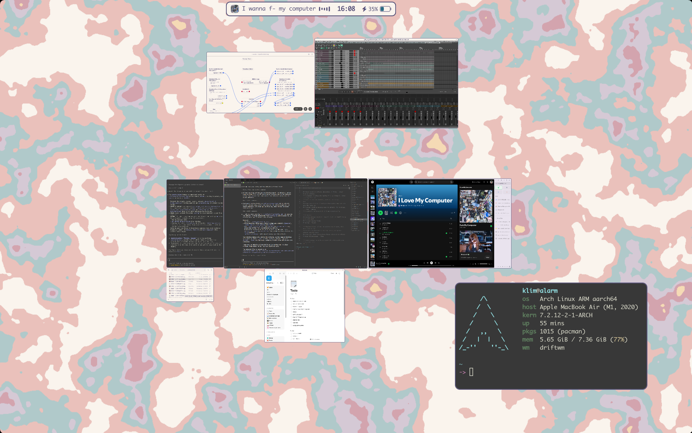

# driftwm-dotfiles

[driftwm](https://github.com/malbiruk/driftwm) rice (Rose Pine Dawn) with [Tide Island](https://github.com/malbiruk/Tide-island-extended) (my fork of Tide Island Extended) as the dynamic island: bar, notifications, OSD, control center, media, tray.

The `main` branch has the previous waybar + widgets setup.



## What's included

```
.config/
  driftwm/      WM config, scripts, wallpaper shaders
  tide-island/  Island settings (userconfig.json), palette (colors.json), alt palette (colors-boho-pink.json), settings-app theme
  foot/         Terminal, zenburn
  fuzzel/       Launcher
  fastfetch/    Fastfetch
  pipewire/     Mono source for the Asahi MacBook Air mic (stereo recordings got the left channel only)
  gtk-3.0/      GTK theme + icon theme + cursor settings
  gtk-4.0/      Same, plus libadwaita color overrides (rose-pine-dawn)
.local/share/icons/elementary-pastel/   Custom icon theme (elementary + Mignon-pastel apps)
.config/systemd/user/                   Weekly pacman update notifier (user timer) + tide-island icon-theme drop-in
```

## Install

```bash
paru -S driftwm quickshell fuzzel foot fastfetch gtklock swayidle brightnessctl \
        sway-audio-idle-inhibit grim slurp wl-clipboard \
        rose-pine-gtk-theme elementary-icon-theme pacman-contrib

git clone https://github.com/malbiruk/driftwm-dotfiles
cd driftwm-dotfiles
git switch dynamic-island
cp -r --backup=numbered .config .local ~/   # repo mirrors $HOME; existing files kept as *.~1~

# Tide Island: clone and run its installer (options: see its README, "Installation")
git clone https://github.com/malbiruk/Tide-island-extended
cd Tide-island-extended && ./install.sh

systemctl --user enable --now foot-server.socket    # mod+return uses footclient

systemctl --user enable --now pacman-update-notify.timer   # optional: weekly update notifier

# optional: fake rounded screen corners (autostart entry in config.toml)
git clone https://github.com/rezzubs/wayland-rounded-corners ~/.local/share/wayland-rounded-corners
cargo build --release --manifest-path ~/.local/share/wayland-rounded-corners/Cargo.toml
ln -s ~/.local/share/wayland-rounded-corners/target/release/rounded-corners ~/.local/bin/
```

See the Tide Island [Installation section](https://github.com/malbiruk/Tide-island-extended#installation) for installer options. It installs and enables `tide-island.service`, a user service tied to `graphical-session.target`, so start driftwm via `driftwm-session`.

Fonts: `Adwaita Sans` in GTK UI (set in `gtk-3.0/settings.ini`, `gtk-4.0/settings.ini`)
and `Monaco Nerd Font` in foot and fuzzel (Tide Island uses it too).

## Notes

- **GTK theme**: `rose-pine-dawn-gtk` from AUR. `gtk-4.0/gtk.css` overrides libadwaita color vars so GTK4 apps match the palette without re-theming.
- **Icon theme**: `elementary-pastel` combines [elementary-icon-theme](https://github.com/elementary/icons) with the colorful app icons from [Mignon-pastel](https://www.gnome-look.org/p/1426967).
- **Tide Island config**: lives in `~/.config/tide-island/userconfig.json` and hot-reloads; the fork's settings app writes only the keys you edit. Set `weatherLocation` to your city.
- **Tide Island icons**: `systemd/user/tide-island.service.d/icon-theme.conf` sets `QS_ICON_THEME=Mignon-pastel`. Install [Mignon-pastel](https://www.gnome-look.org/p/1426967) into `~/.local/share/icons`.
- **Lock and caffeine**: `lockCommand` points to `driftwm/scripts/lock.sh` (gtklock, expects a background at `~/Pictures/leafy-dawn.png`). The caffeine button runs `driftwm/scripts/caffeine.sh`: on swaps `idle.sh` for a swayidle that only locks before sleep and blocks lid suspend, off restarts `idle.sh`.
- **Keybinds**: `mod+e` control center, `mod+n` notifications, `mod+v` clipboard, via `quickshell ipc -p /usr/share/tide-island call tide …` in `config.toml`.
- **Rounded corners**: `rounded-corners --radius 10` in autostart draws fake rounded screen corners. [wayland-rounded-corners](https://github.com/rezzubs/wayland-rounded-corners) isn't packaged — build it as above, or drop the autostart line.
- **Update notifier**: `driftwm/scripts/pacman_update_notify.sh` fired weekly by the user timer in `systemd/user/`. Uses `checkupdates` from `pacman-contrib`.
- **Mic (Asahi, MacBook Air M1)**: asahi-audio labels the processed mic channel `AUX0`, so stereo recorders (Tide Island's mic recording, OBS) get it on the left channel only. `pipewire/pipewire.conf.d/50-j313-mic-mono.conf` re-exposes it as a `MONO` source, `j313-mic-mono`. Make it the default with `pactl set-default-source j313-mic-mono`. Skip this file on other hardware.

## License

MIT. See [LICENSE](LICENSE).
